# DevOps Software Engineering Assignment

## Introduction
This application is a Django website with a single database table and functions to display a members list.
I've used Django/Python framework as it has extensive libraries and testing facilities.
(_and, I'm trying to learn Python_). I've used PyCharm IDE which allows me run/basic test applications in a virtual python enviroment locally before transfer to a docker desktop on the laptop, or to a container environment. 

| Homepage                      | Note                                                               |
|-------------------------------|--------------------------------------------------------------------|
| 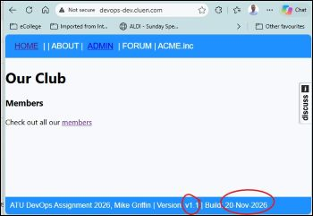 | - App version is taken from git tag </br> - date is the build date |
| 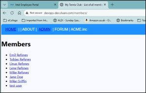  | The app has drilldown to members list and individual member       |


## Build/Deployment Environment 
I'm using a Promox homelab server that I've used for development projects. 
The relevant items for this assigment are : 

| Item                      |Description| Notes                                                                                                                                                                                                      |
|---------------------------|----|------------------------------------------------------------------------------------------------------------------------------------------------------------------------------------------------------------|
| Container Orchestration   |Kubernetes(rke2)| I have confgured a 2 node rke2 cluster. This is managed from command line and an open source GUI "Headlamp".                                                                                               |
| GitHub Runner             |Ubuntu 22.04 node VM| This is configured as a "self hosted" github runner for this repo. It has docker, python testing tools (playwright, pytest, chromium)                                                                      | 
| Code Analysis (SonarQube) |LXC Ubuntu 22.04 container| This LXC container has docker and the SonarCube images (website/db) installed , running on http://192.168.1.92 locally.                                                                                    | 
|Monitoring||                                                                                                                                                                                                            |
|DNS|PiHole| PiHole is a DNS server and ad-blocker commonly used in home networks.</br>. It is installed as a lightweight VM on the Promox host. This allows creation of human readable domain names, easier management |
|Code Quality|SonarCube| This is installed as  LXC container on the promox host. |                                                                                                                                                                                         

**Kubernetes Environment**
To create a "near-production" scenario, I've setup 2 namespaces on the Kubernetes cluster - dev + prod. 
The thinking is that I would regularly (or continually) build the package, push to a registry and install the app on "dev". 
Once approved (this could be a combination of user tests / CAB approval etc) the package can be pulled from the registry and installed on "prod"

**Container Registry**
I've used GitHub Container Registry (GHCR) to store the package. 

## CI/CD Tools & Integration ###

**GitHub Actions**
GitHub Actions workflows act as the CI + CD platforms to automate the build/test and deployment. 
- Summary: 
 - There are 2 workflows (CI_workflow.yaml and CD_workflow.yaml).
 - When CI_workflow.yaml runs to completion, it triggers CD_workflow.yaml to complete the deployment step to the "dev" namespace automatically. 
 - CD_Workflow.yaml is used also for "prod", it can be triggered seperately(workflow dispatch) to install on prod.


|Workflow| Image| Notes                                                                                                                                                                                                                                |
|----|----|--------------------------------------------------------------------------------------------------------------------------------------------------------------------------------------------------------------------------------------|
|CI_workflow.yaml|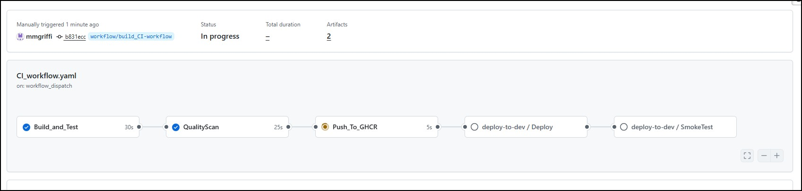| -Build docker image and runs unit tests<br/>-Run SonarQube scan<br/>-Push to GHCR<br/>- **Next** trigger CD_workflow.yaml to install on "dev" (see below)                                                                            |
|CD_workflow.yaml|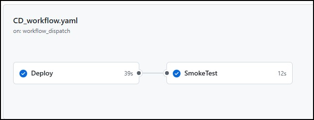| -Manual trigger or call from CI_workflow. User can select "prod" or default to "dev"</br> -Updates (sed) "prod" or "dev" in kubernetes yaml files </br> -Deploy/redeploy from GHCR </br> -run Playwright smoke test from runner |

**Kubernetes Configurations**
Before these are applied, I use sed to swop a placeholder value of "ENV" in the repo file  with the actual value (dev or prod is passed from the actions input) .
When these yaml files are applied the resources are created in the corresponding namespace, using a different url for the dev or prod website. 

In my DNS server/environment I have an entry mapping each hostname to the IP address of the cluster.

| url                                                                      | DNS                             |
|--------------------------------------------------------------------------|---------------------------------|
| http://devops-dev.cluen.com </br> and </br> http://devops-prod.cluen.com | 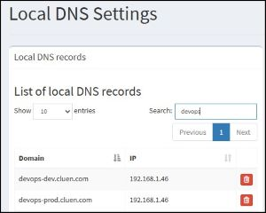 |

|Name|Image| Notes                                                                                                                |
|----|----|----------------------------------------------------------------------------------------------------------------------|
|Deployment.yaml|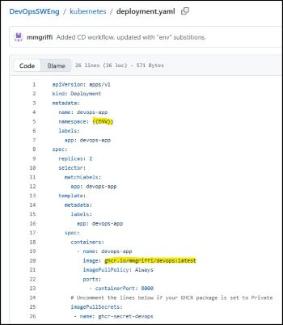| name space is passed from GH inputs, and using GHCR registry                                                         |
|service.yaml|[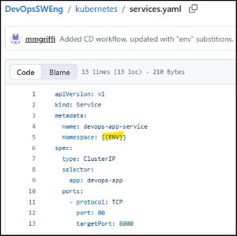| namespace is passed from GH inputs </br>using a cluster IP service mapping port 80 to the internal running port 8080 |
|Ingress.yaml|[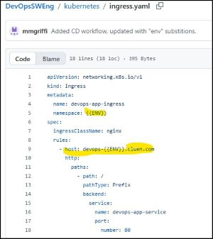|maps the service to host (devops-prod , or devops-dev)|


## Notifications ##

**Clickup**
ClickUp is linked with my repos 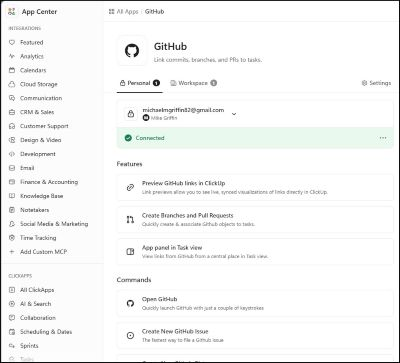
From that, ClickUp can create Issues/Pull Requests/Create Branches on the repo.  From GitHub you can close the issue and the status is reflected 
on the ClickUp task if you use some keywords in the comment such as Fixes CU-1amhxucrzgq
(CU-1amhxucrzgq is the task-ID, not it's name).
If you're commiting or doing a pull merge this keywork will move the task status.
CU-1amhxucrzgq[<state name>]  (to do, in progress, complete )  are the only states I've used. 

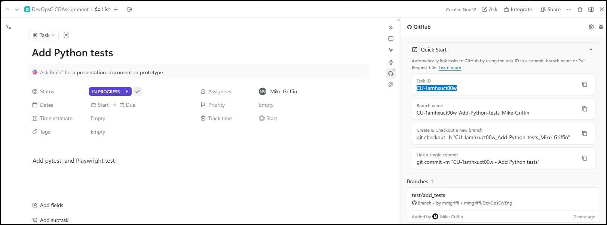

_Overall, found the integration between ClickUp and GitHub loose, you needed to be disciplined in how Issues/PRs are managed in GH or Click won't update.. but it works_

**Slack & email**
On my account I setup GitHub integrations allow communictation with Slack. (set for this repo only.), and I created a communication channel "devops_sw_assignment".
I get notifications on issues, commits , pull requests.
I have configured email notifications on my GitHub account, so I'm getting emails on Workflow failures. 

| Slack (cell-phone screen)                      |Email|
|------------------------------------------------| ----|
| 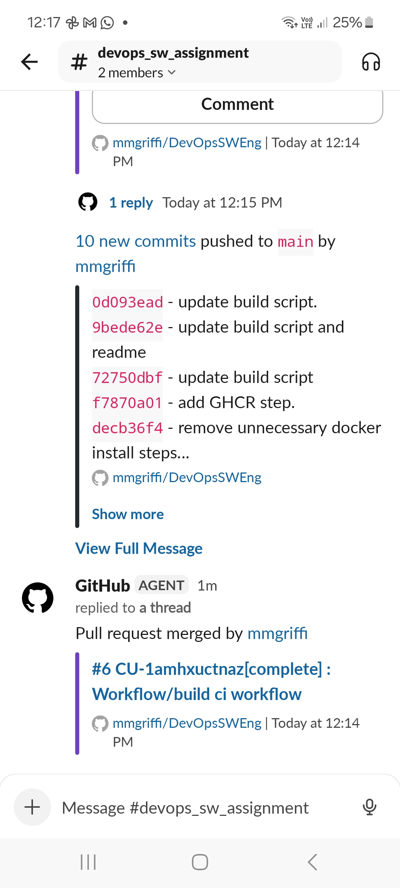 |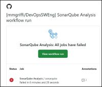|

### Testing ###

**Testing**
 - **Unit Test:** I'm using **pytest* and **coverage** to execute unit/internal tests defined in DevOpsSWEng\my_tennis_club\members\tests.py. These validate the python functions that add a user, and the views to display member listings.
 - **Build/Integration test:** For local validation of the build, I start the container on the runner system and use pytest-playwright to execute tests (http://127.0.0.1:8000) . These verify the container has started correctly and that functions like displaying a list of users work.
 - **Smoke Tests:** Once deployed on the Kubernetes cluster I execute smoke tests using the actual URL (http://devops-dev.cluen.com or http://devops-prod.cluen.com). This is the final validation that the Kubernetes pods/services/ingress is working.

**Code Quality/Coverage**
I have setup SonarQube on a VM with a project connected to this repo, plus GitHub secrets (see SONAR_HOST URL and SONAR_TOKEN secrets ).
The GH action setp for checking the quality gate was set to allow it continue on error (while debugging issues with how sonar qube was reading python test output)

|Image | Notes                                                                                                                                                                                            |
|----|--------------------------------------------------------------------------------------------------------------------------------------------------------------------------------------------------|
|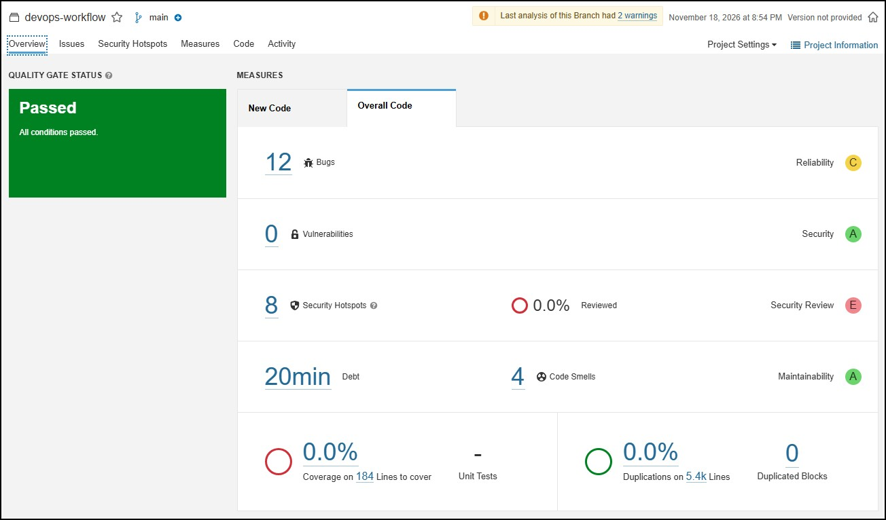| This first scan flagged issues with the Django code I got from the </br> tutorial. This is the baseline. I configured the scans to look at new code only, but these can be </br> corrected later |
|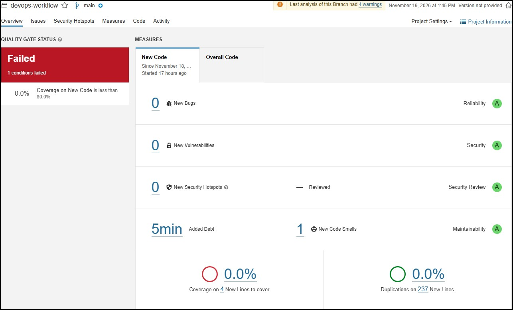| The 2nd scan (for new code) flagged multiple code coverage issues. </br> On research found this was because the unit test coverage report was being missed and the python test file itself was being scanned|
|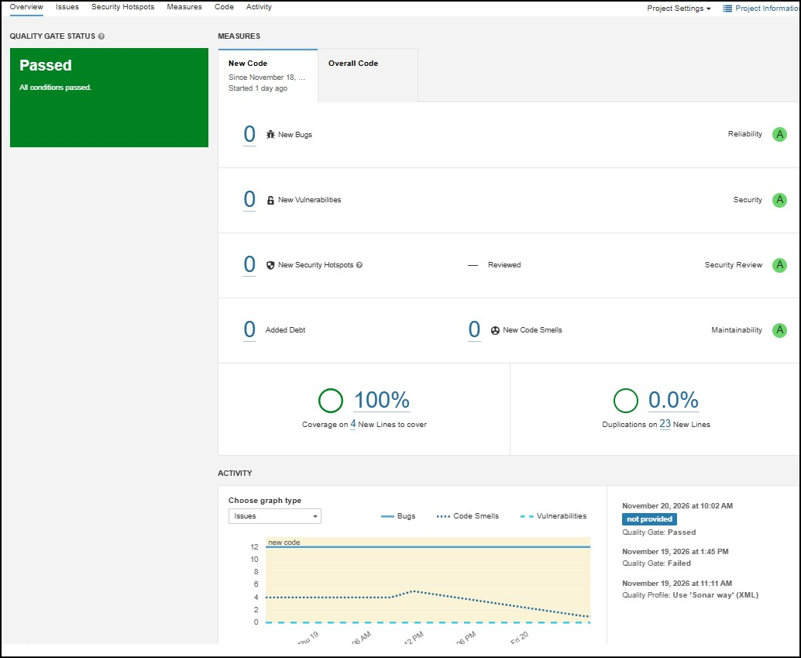| After correcting the CI_workflow.yaml steps for running coverage and where SonarQube scan checked, coverage is now passing|

**Monitoring***

<todo>

**New version Deployment**
 - When you are ready to push a new version and include a tag do the following :
```` 
     git tag v1.1 
     git push --tags
     
     _verify_
     git describe --tags
````
- Commit and push changes to the branch.
- Run GitHub Actions "CI_PipeLine" CI_workflow.yaml. This 

**Improvements**
- Should tag the GHCR images by version number.  Also look at how rollbacks can be made easier by using tagged images.
- Workflow automation. Automate messages for approvals, triggering the deployments to prod (or dev). In the past I've done this using simple updates to </br>
a "signal" file that the workflow scans for , waits. 
- 

**Application Revision History**
After I got the initial website/ app running .  I have used tagged some of the commits (not every workflow correction was included) to mark the main changes 

|Version|Notes|
|----|----|
|v1.0|1st version, website and basic deployment workflows working|
| v1.1| Added version + build info to footer page.  added SonarCube Scans|
